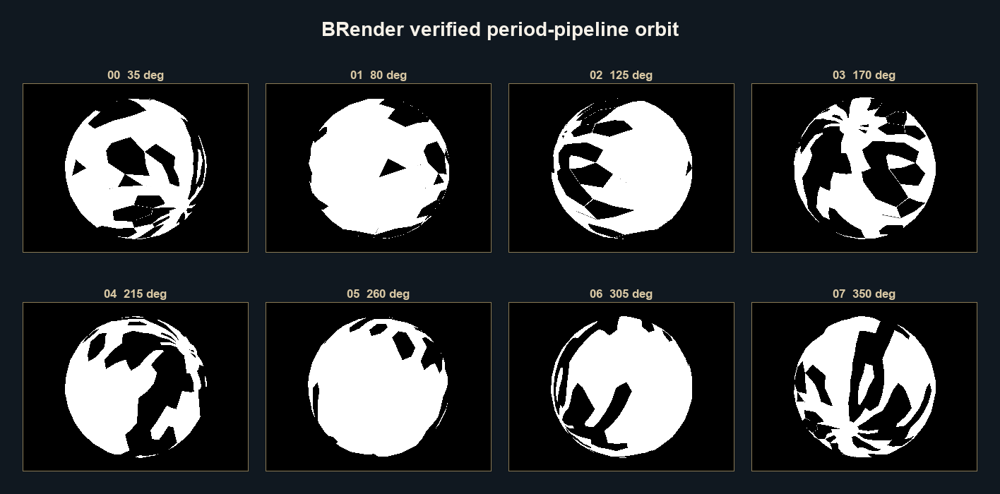
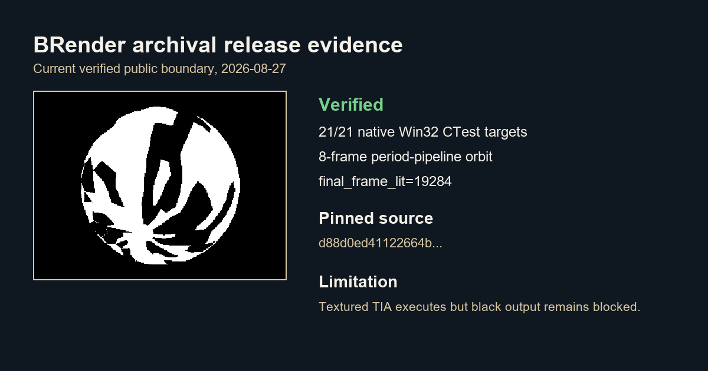
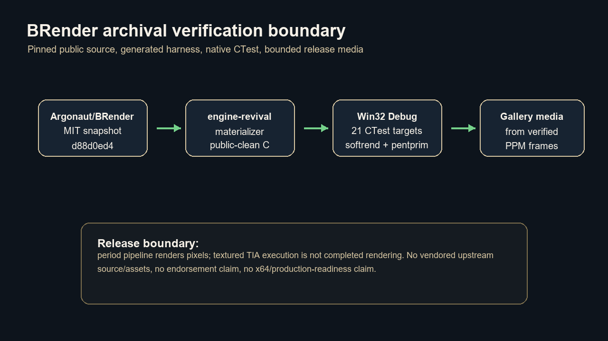
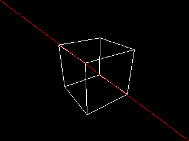
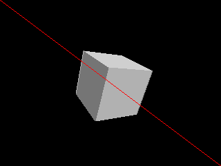
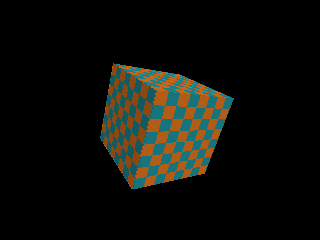
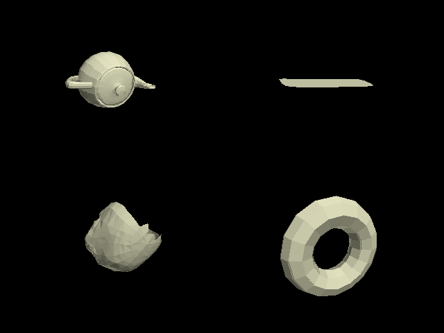

<picture>
  <source media="(prefers-color-scheme: dark)" srcset="https://raw.githubusercontent.com/HarperZ9/brender-archival/main/docs/art/hero-dark.svg">
  
</picture>

# brender-archival

Run Argonaut's 1990s BRender 3D engine on a modern 64-bit PC, and rebuild the
original 1998 source with a build anyone can rerun.

[](https://github.com/HarperZ9/brender-archival/releases/latest)
[](https://github.com/HarperZ9/brender-archival/actions/workflows/ci.yml)
[](https://github.com/HarperZ9/brender-archival/blob/main/LICENSE)


BRender is the real-time 3D engine Argonaut Software sold in the 1990s, best
known from games such as Carmageddon and Croc. Its source was published under
the MIT licence. This repository gives you three things built on it:

- **brview**, a model viewer for 64-bit Windows and Linux that opens the
  engine's 1998 sample models, with mouse, keyboard and gamepad controls and
  an optional 256-colour period look.
- **The Keeper's Hour**, a short original game on the same engine: the last
  night of a lighthouse, told through conversation, with three endings.
- **A rebuild of the original v1.3.2 source.** A generator writes a CMake
  project around an unmodified checkout of the public source, and a ladder of
  21 small test programs builds and runs it, from vector maths up to the
  period software rasteriser drawing a sphere.

It is for people who want to see or study a 1990s software renderer running
today, for preservation and retro-graphics work, and for developers who want
a starting point on the maintained BRender fork. No proprietary source, game
assets or restricted material are stored here.

## Run it

Download `brview-<version>-windows-x64.zip` or `brview-<version>-linux-x64.tar.gz`
from [releases](https://github.com/HarperZ9/brender-archival/releases), check
it against the `.sha256` file beside it, unpack it and run `brview.exe`
(Windows) or `./brview` (Linux). Nothing to install. Tab cycles the models,
mouse drag orbits, and `8` turns the 256-colour look on and off.

```text
brview.exe                    cycle through the bundled models
brview.exe my.dat my.pix      open your own model and texture
brview.exe --force-software   draw with BRender's software rasteriser
```

To save one frame and quit, set `BRVIEW_SHOT=frame.ppm`; `BRVIEW_SCENE=n`
picks the model. The Keeper's Hour downloads (`keepers-hour-<version>-windows-x64.zip`,
a Linux tarball and an AppImage) are on the same releases page; it takes about
25 minutes to play. Its source is in [games/keepers-hour](games/keepers-hour/README.md);
code MIT, words and art CC BY 4.0.

Both are built on BRender 1.4 from
[BlazingRenderer/BRender](https://github.com/BlazingRenderer/BRender), the
maintained modern fork (MIT), which replaces the x86 assembly with portable C
and adds SDL and OpenGL drivers. The same 21-program ladder passes against it
as a 64-bit build. How it is built and pinned: [modern/README.md](modern/README.md).
What comes next, in order: [docs/ROADMAP.md](docs/ROADMAP.md).

## Limits

- The viewer and game need OpenGL 3.3, or the software renderer with
  `--force-software`. On Linux they need glibc 2.38 or newer (Ubuntu 24.04,
  Debian 13, Fedora 39 or later).
- The rebuild of the original v1.3.2 source is verified as a 32-bit
  Visual Studio Debug build only. Several of the original assembly routines
  are replaced by C stand-ins, and textured rendering through the original
  period pipeline still draws black (see the next section).
- The repository also holds research records on 22 other engines and
  graphics libraries, as JSON metadata and links to public sources. No build
  exists here yet for any of them.

## How it compares

- **[BlazingRenderer/BRender](https://github.com/BlazingRenderer/BRender)** is
  the maintained engine itself. This repository does not fork it; it pins one
  commit, builds the viewer and game on it, and checks the result against the
  1998 code.
- **Foone Turing's [BRender-v1.3.2](https://github.com/foone/BRender-v1.3.2)**
  and the other published snapshots hold the original source as released.
  This repository adds the build around that source and the tests that run it.
- **Emulators and DOSBox** run the original games as shipped binaries. This
  repository runs the engine as source code on current systems, so you can
  read it, change it and build new work on it.

## The 1998 source, rebuilt

From the public BRender v1.3.2 source snapshot (MIT, provenance via Foone
Turing, release authorized by former Argonaut CEO Jez San), pinned at commit
`d88d0ed41122664b9781015b517db64353e16f19`, the materializer generates an
out-of-tree CMake harness that references the source checkout in place.

Verified on 2026-08-27 as a Visual Studio Win32 Debug build:

- 21/21 native CTest targets pass.
- The period-pipeline rung compiles softrend and pentprim from the upstream tree
  itself, binds pentprim's primitive library, and drives
  `BrZbSceneRender`.
- The period-pipeline rung renders `dat/sph32.dat` as an eight-frame nonblack
  orbit and reports `final_frame_lit=19284 valid=true` for the release media
  source run.
- Release hardening covers generated-C JSON escaping, caller-owned workfile
  protection, material-resolve third-edge initialization, INDEX_8 palette
  lookup, and removal of stale investigation diagnostics.

The experimental textured path through the original pipeline runs but draws
black, because of a measured vertex-layout and state mismatch. For this 1.3.2
rebuild there is no claim of completed textured rendering, a 64-bit build or
production use, and no endorsement by the original authors. The 64-bit build
is the BRender 1.4 one described above.

![Eight stages taking pinned upstream source to a running ladder: pin, materialize, compat, configure, build, ladder, capture, package. One upstream commit of the public BRender v1.3.2 source is named in the record. The materializer writes forty files out of tree, none of them copied from upstream: the CMake project, the compatibility C ports that stand in for the period assembly kernels, and the smoke programs. CMake configures a Visual Studio Win32 target against the named source directory, and the FLOAT core is built from eight upstream directories under nine compile definitions. Twenty-one targets then run under CTest, twenty from the generated project plus the period-pipeline rung that binds softrend and pentprim into one process. Frames and transcripts are captured, and the packager hashes everything it stages. The transcript recorded on the twenty-seventh of August 2026 reports twenty-one of twenty-one passed with none failed. Three outcomes: the ladder renders a nonblack orbit, some assembly kernels remain linkage stubs, and a completed textured period render is not claimed.](docs/art/ladder-lane.svg)

| Rung | What it proves |
|---|---|
| Vector math | scalar and vector core |
| Framework startup | `BrBegin` / `BrEnd` |
| Wireframe | `BrMatrix4Perspective` into a memory pixelmap |
| Scene graph | model actors projected through BRender's v1db transforms |
| Solid shaded | portable C scanline rasterizer, per-face lighting |
| Depth buffer | per-pixel occlusion in the portable rung |
| Textured | perspective-correct texture mapping in the portable rung |
| Datafile models | `BrModelLoad` renders real `.dat` models |
| UV-textured models | loaded model UV coordinates drive texture sampling |
| Multi-part assembly | `BrModelLoadMany` composites the 12-part coupe |
| Gouraud shading | per-vertex normals and smooth gradients |
| Plotter output | hidden-line-removed SVG polylines, pen-plotter ready |
| Asset audit | loaded model geometry, face indices, degenerate faces, and material attachment |
| Pixelmap audit | `BrPixelmapLoad` probes period `.pix` and `.pal` files |
| Material audit | `BrMaterialLoad` identifiers, flags, index_base, and colour-map attachment |
| Pixelmap round trip | `BrPixelmapSave` then reload, with safe caller-owned workfile handling |
| Material resolve | `BrMaterialLoad` material attached to loaded model faces and rendered |
| File-texture sampling | loaded period `.pix` sampled with palette-aware INDEX_8 lookup |
| Game shell | deterministic INIT/LOAD/RUN/TEARDOWN frame loop over loaded assets |
| Host semantic | host file round trips without deleting preexisting caller-owned workfiles |
| Period pipeline | softrend plus pentprim built from upstream, nonblack ZB sphere output |

## Release media

The current public media is generated from verified nonblack render output or
from factual diagrams/cards. Black diagnostic frames and generative imitation
are excluded. Provenance, commands, dimensions, hashes, input attribution,
metrics, and limitations are recorded in
[gallery/release-20260827/provenance-manifest.json](gallery/release-20260827/provenance-manifest.json).

| | |
|---|---|
|  |  |
|  |  |

The social preview card is
[gallery/release-20260827/social-card-1200x630.png](gallery/release-20260827/social-card-1200x630.png).
The full progress sequence is
[gallery/release-20260827/progress-sequence.png](gallery/release-20260827/progress-sequence.png).

## Gallery

These captures are produced by render smokes from BRender's public sample
models. They are public release output, not vendored upstream assets.

| | |
|---|---|
|  |  |
|  |  |
|  |  |
|  |  |
|  |  |

The plotter rung also writes ready-to-plot SVG:
[gallery/10-teapot-plotter.svg](gallery/10-teapot-plotter.svg).

See [docs/BRENDER-ARCHIVAL.md](docs/BRENDER-ARCHIVAL.md) for the full packet:
provenance, reproduction, current capability and known limits.

## Package a release

```powershell
python scripts/package_brender_release.py `
  --source-root <BRender-v1.3.2 checkout> `
  --output-root <release stage directory>
```

The packager stages the materialized harness, README, CTest transcripts, current
release media, provenance manifest, `SHA256SUMS.txt`, and
`package-receipt.json`. No proprietary source or assets are copied.

## Reproduce the BRender build

The `engine-revival` command comes from the [Engine Revival](https://github.com/HarperZ9/engine-revival)
package, pinned in `pyproject.toml`; installing this repository installs it.

```powershell
python -m pip install -e ".[test]"
engine-revival materialize-brender-harness `
  --source-root <BRender-v1.3.2 checkout> `
  --output-root <harness directory>
cmake -S <harness> -B <build> -A Win32 "-DBRENDER_SOURCE_DIR=<BRender-v1.3.2 checkout>"
cmake --build <build> --config Debug
ctest --test-dir <build> -C Debug --output-on-failure
```

`brender_core_model_smoke <model.dat> <out.ppm>` doubles as a minimal viewer for
the period asset library.

## Archive workflow

![Eight stages taking a lead from an empty directory to a published page: seed, record, schema, validate, rights, audit, index, publish. The seed command lays out one directory per record kind, twelve of them, covering targets, artifacts, sources, tasks, milestones, accessions, reproductions, snapshots, readiness, builds, harnesses and attempts. Each finding becomes one JSON file. Twelve schemas name the fields a record of that kind must carry, and the validate command reports any record that omits one. Every artifact carries a redistribution status and an access level, and the audit command refuses the combination of restricted material with a publishable level. The index command renders the twenty-three engine targets as one table, and the report command writes the generated pages out of the corpus. Three hundred and forty-two records sit on disk across the twelve kinds, and the audit returns no messages against them on this checkout. Three outcomes: a public record whose page regenerates from it, a reference held as metadata only, or a holding that is not held at all.](docs/art/archive-lane.svg)

```powershell
python -m pip install -e ".[test,media]"
engine-revival seed
engine-revival validate
engine-revival audit-public
engine-revival index
engine-revival report
python -m pytest
```

Findings live as structured JSON records first (`readiness/`, `harnesses/`,
`attempts/`, `reproductions/`, `sources/`, `targets/`, ...), and generated pages
under `docs/generated/` are views over that corpus.

![A table of twelve rows: what is in the archive, how many of it there are, and where each number is read from. Twelve record kinds are named in RECORD_DIRS, and three hundred and forty-two JSON records sit across their directories, with sources leading at seventy-eight and artifacts and accessions at sixty each. Twenty-three engine targets span fifteen categories: eight carry curated public sources and fifteen carry curated public metadata. Sixty-two of the seventy-eight sources are rated high confidence and sixteen moderate. Five artifacts are marked do-not-redistribute; four are metadata-only and one is public-reference, so none of them is publishable, and their accessions all record no holding. The audit command returns no messages against the whole corpus. Twelve schemas name the required fields. The report command writes two hundred and fourteen files and leaves the tree byte-identical. The BRender ladder runs twenty-one targets under CTest, the materializer generates fifty-one files, and the FLOAT core is built from eight upstream directories under nine compile definitions. Eighty-nine Python tests cover the release media, the packager, the project metadata, the modern build pins, the game script and every number drawn here; the engine-revival package carries its own tests.](docs/art/corpus-table.svg)

## License

MIT, the same terms Argonaut's BRender v1.3.2 was published under. Copyright
2026 Zain Dana Harper; see [LICENSE](LICENSE). This covers the whole
repository, `gallery/` included.

- The C ports of BRender routines that the harness builds ship in the
  engine-revival package (`engine_revival/brender_compat/`), MIT, with their
  upstream notice. Material from BRender keeps that notice, copyright 1998
  Argonaut Software Limited, also kept here in
  [LICENSES/MIT-BRender.txt](LICENSES/MIT-BRender.txt).
- `gallery/` holds frames rendered with BRender. See
  [gallery/LICENSE-NOTE.md](gallery/LICENSE-NOTE.md).

Releases 0.1.1 and earlier were published under AGPL-3.0-or-later, and 0.2.0
under FSL-1.1-MIT; those copies keep the terms they shipped with. The BRender
source itself is fetched from the public upstream and never vendored here.
Records under `sources/`, `snapshots/`, `artifacts/` and `targets/` describe
other projects; any text they quote stays with its owner.

## Public docs

- [Revival mission](docs/REVIVAL-MISSION.md)
- [BRender archival packet](docs/BRENDER-ARCHIVAL.md)
- [Public boundary](docs/PUBLIC-BOUNDARY.md)
- [Recovery workflow](docs/RECOVERY-WORKFLOW.md)
- [Generated public index](docs/generated/index.md)
- [Generated corpus database](docs/generated/database.json)
- [Generated production readiness](docs/generated/production-readiness.md)
- [Generated harnesses](docs/generated/harnesses.md)
- [Generated attempts](docs/generated/attempts.md)
- [Contributing](CONTRIBUTING.md)

---

Built by **[Zain Dana Harper](https://harperz9.github.io)** in Seattle.
An independent lab building evidence-first tools that leave a re-checkable
artifact behind. Built by Zain Dana Harper in Seattle. The full workbench is at
[Project Telos](https://harperz9.github.io).
