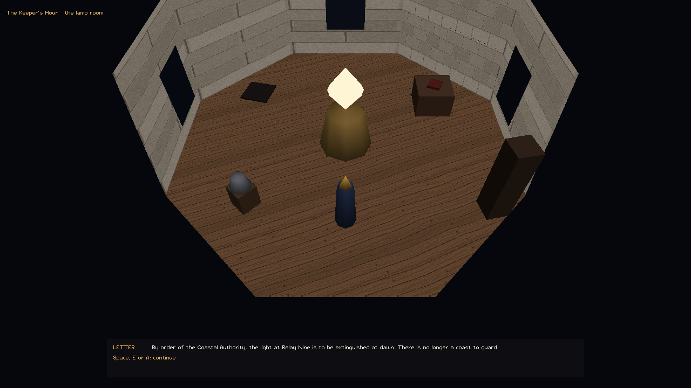
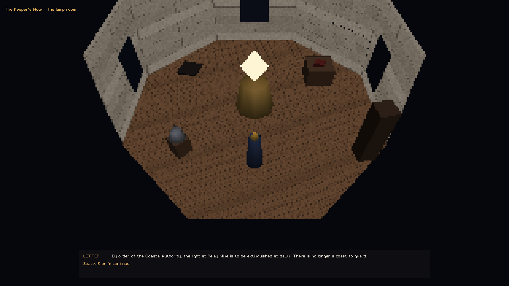

# The Keeper's Hour

A short, strange, talkative game about the last night of a lighthouse on a
coast the sea left years ago. Built on BRender, the 1990s Argonaut engine,
running 64-bit on a modern PC. The design is in [DESIGN.md](DESIGN.md).

**Milestone M4: released.** Credits on the dawn card and in CREDITS.txt; the
release workflow publishes a build only after the packaged copy passes the
full smoke run. All four milestones in DESIGN.md are done.

**Milestone M3: craft.** Textured stone, boards and pictures; sound made in
code; an options screen with volume, look speed and key remapping (F2); and
the same scene on OpenGL and on BRender's software rasteriser
(`--force-software`), checked room by room.

**Milestone M2: a complete short game.** Five rooms (the lamp room, the stairs,
the radio room, the keeper's room and the gallery outside), 15 things to talk
to, 80 script nodes, and three endings at dawn, opened by what you found in the
night. The night saves every time you change room, and the next start offers
to carry on. Every skill check shows its sums.

**Download:** `keepers-hour-<version>-windows-x64.zip` for Windows or
`keepers-hour-<version>-linux-x64.tar.gz` for Linux, on the
[releases page](https://github.com/HarperZ9/brender-archival/releases). Unpack
it and run `keepers-hour.exe` or `./keepers-hour`; the SHA-256 is beside each
download. Linux needs OpenGL 3.3 (X11 or Wayland) and glibc 2.38 or newer.

## Build it

Or build it with the modern BRender build (see [../../modern/README.md](../../modern/README.md)):

```
cmake -S modern -B build -A x64
cmake --build build --config Release
build\keepers-hour\Release\keepers-hour.exe
```

On Linux: `bash scripts/linux-build-deps.sh`, then
`cmake -S modern -B build -G Ninja -DCMAKE_BUILD_TYPE=Release`,
`cmake --build build` and `./build/keepers-hour/keepers-hour`.

| Action | Keyboard and mouse | Gamepad |
|---|---|---|
| Walk | WASD or arrows | left stick |
| Turn the view | hold right mouse and move | right stick |
| Talk, continue, choose | E, Space, Enter or left click | A |
| Pick a reply | 1 to 4, or Up and Down then E | D-pad, then A |
| Leave a conversation | Esc | B |
| Options: volume, look speed, pixel size, field of view, vsync, key remapping | F2 | Back |
| Fullscreen | Alt+Enter | |
| Quit | Esc outside a conversation | |

For films: `KEEPERS_RECORD=<dir>` writes numbered PPM frames at a fixed step
of game time, with no wall clock, so two runs give the same bytes. Settings
are in [src/kh_capture.h](src/kh_capture.h); one lamp sweep, 30 frames a
second, slowly turning:

```
set KEEPERS_ROOM=lamp
set KEEPERS_RECORD=frames
set KEEPERS_FPS=30
set KEEPERS_SECONDS=4
set KEEPERS_YAW_SPEED=6
keepers-hour.exe
```

`KEEPERS_SHOT=<file.ppm>` draws one still; `KEEPERS_CLOCK=<seconds>` sets the
lamp's angle for it (90 degrees a second).

For writers: `KEEPERS_OPEN=lamp keepers-hour.exe` starts inside any node of
[data/night.txt](data/night.txt), and `KEEPERS_ROOM=gallery` starts in any room. `KEEPERS_SMOKE=1` opens every node once and
reports problems; CI runs it, and `tests/test_keepers_script.py` checks that
every link resolves and every node can be reached.

## Display

The window resizes, and Alt+Enter switches to fullscreen. The field of view
is vertical, so a wider screen shows more of the room to the sides rather
than cutting off the top and bottom. F2 sets:

- **Pixel size**, 1 to 6: the room is drawn that many times coarser and
  scaled up with whole, square pixels, for a period look. Text stays sharp.
- **Field of view**, 40 to 90 degrees (default 55).
- **Vsync**, on or off (OpenGL).

| Pixel size 1 | Pixel size 4 |
|---|---|
|  |  |

`tools/display_check.py` draws the lamp room headless and checks the claims on
frames: whole pixels at size 4 (a control at size 1 must fail), the same
scene at both sizes, Hor+ at 4:3, 16:9 and 21:9 (a control at another field
of view must fail), and that the field of view changes the picture. CI runs it
on Windows and on Linux, on the software rasteriser and on OpenGL.
`KEEPERS_PIXEL` and `KEEPERS_FOV` set the two for one run without saving them.

## Licence

Code MIT. Words and art CC BY 4.0, with the reasons in
[LICENSE-NOTE.md](LICENSE-NOTE.md).
