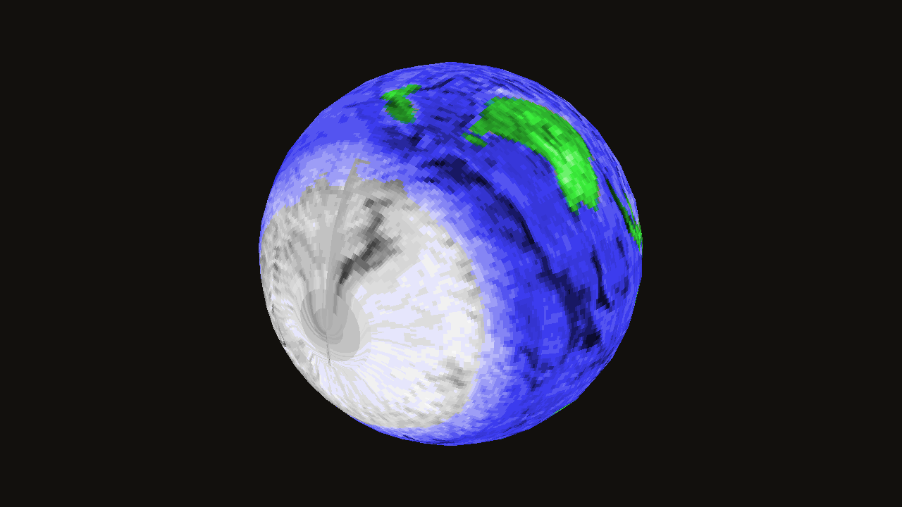
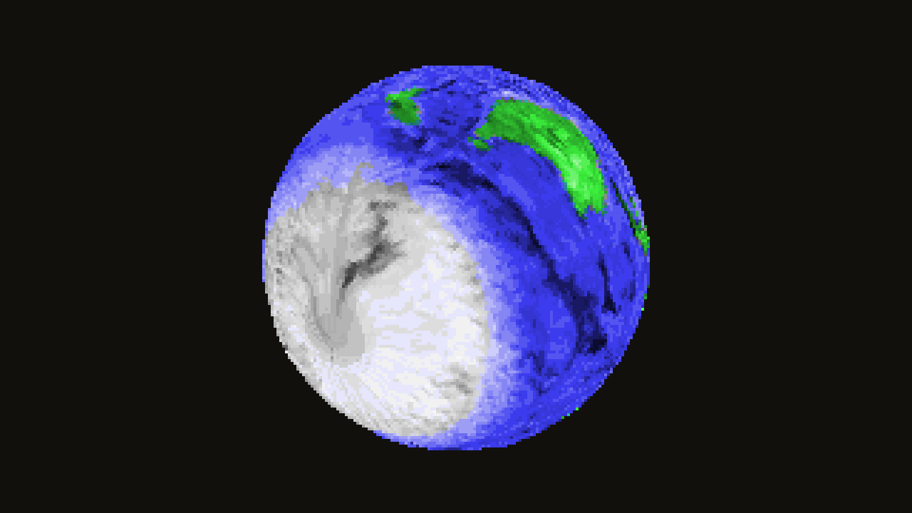

# BRender on a modern PC

Run Argonaut's 1990s BRender engine on a 64-bit Windows or Linux PC, open its period
sample models in a viewer, and check that the restored engine still does what
the 1998 one did.

## Get the viewer

Download `brview-<version>-windows-x64.zip` or
`brview-<version>-linux-x64.tar.gz` from the
[releases page](https://github.com/HarperZ9/brender-archival/releases), unpack
it and run `brview.exe` (Windows) or `./brview` (Linux). Nothing to install.
Each download carries its SHA-256 beside it.

On Linux the viewer needs a desktop with OpenGL 3.3 (X11 or Wayland) and
glibc 2.38 or newer: Ubuntu 24.04, Debian 13, Fedora 39 or later. SDL3 ships
in the folder, and the program finds it there through a `$ORIGIN` run path.

| Input | Action |
|---|---|
| Mouse drag | orbit |
| Right or middle drag | pan |
| Wheel, Q and E | zoom |
| WASD or arrow keys | orbit |
| Tab or N, P | next, previous model |
| T | texture on or off |
| Space | spin on or off |
| R | reset the view |
| H or F1 | hide the help |
| [ and ] | pixel size, 1 to 6 (a coarser, period look) |
| - and = | field of view, 40 to 90 degrees |
| V | vsync on or off |
| 8 | period look on or off: 256 colours through BRender's 8-bit path |
| Alt+Enter | fullscreen |
| Gamepad | left stick orbit, triggers zoom, A next, X previous, B spin, Y texture, Start reset |

The pixel size draws the model that many times coarser and scales it up with
whole, square pixels; the text stays sharp. The field of view is vertical,
so a wider window shows more to the sides. Both are saved, with vsync, in
your preferences folder.

| Pixel size 1 | Pixel size 4 |
|---|---|
|  |  |

The period look draws the model into an 8-bit buffer through BRender's own
palette path and shows it through `std.pal`: an untextured model climbs the
palette ramp nearest its colour, and a textured one uses its 8-bit map lit
through the first 37 rows of `shade.tab`, so full light keeps the map's
colours instead of washing them out to white. It needs the software
renderer; brview starts on it when the look was left on, and
`BRVIEW_PERIOD=1` turns it on for one run. BRender 1.4's 8-bit kernels match
the 1998 ones to 96.4% to 99.9% of pixels on the same palette index
(`parity/README.md`).

| True colour | Period look, 256 colours |
|---|---|
|  |  |

```
brview.exe                    cycle through the bundled models
brview.exe my.dat my.pix      open your own model and texture
brview.exe --force-software   draw with BRender's software rasteriser
```

## What it is built on

The engine is **BRender 1.4 from [BlazingRenderer/BRender](https://github.com/BlazingRenderer/BRender)**,
the maintained modern fork by Zane van Iperen, erysdren and contributors
(MIT). It replaces the x86 assembly rasteriser with portable C, adds SDL2/SDL3
and OpenGL drivers, and builds 64-bit. This repository does not fork it: the
build pins one commit and fetches it, and the credit and licence travel with
every binary.

That choice can be reversed. If the archive later needs its own 64-bit
branch of the 1.3.2 source, `modern/` is the only place that names the
dependency, and the period build in the rest of this repository does not use it.

| Part | Source | Licence | Pin |
|---|---|---|---|
| Engine | BlazingRenderer/BRender | MIT | commit `ed5e7a91` |
| Window, input, gamepad | SDL3 | zlib | `release-3.4.16` |
| Sample models and textures | foone/BRender-v1.3.2 (Argonaut Software, 1998) | MIT | commit `d88d0ed4` |
| brview, ladder64 | this repository | MIT | |

## Build it yourself

Needs CMake 3.24 or newer, a C compiler (Visual Studio 2022 or newer on
Windows), and `glslang` and `spirv-cross` on the PATH for BRender's OpenGL
driver (both come with the Vulkan SDK, or `vcpkg install glslang[tools]
spirv-cross`). The first configure fetches the three pinned sources.

```
cmake -S modern -B build -A x64
cmake --build build --config Release
build\Release\brview.exe
```

On Debian or Ubuntu, `scripts/linux-build-deps.sh` installs the compiler,
the shader tools and the X11, Wayland and audio headers SDL3 needs (CI runs
the same script):

```
bash scripts/linux-build-deps.sh
cmake -S modern -B build -G Ninja -DCMAKE_BUILD_TYPE=Release
cmake --build build
./build/brview
```

To build against a local BlazingRenderer checkout, add
`-DBLAZINGRENDERER_SOURCE_DIR=<checkout>`.

## The 21-step ladder, 64-bit

The period ladder (21 test programs, from vector maths to a textured model
drawn by the renderer) builds BRender 1.3.2 itself, Win32 only. `ladder64`
runs the same programs against BRender 1.4, 64-bit:

```
pip install -e .
engine-revival materialize-brender-harness --source-root BRender-v1.3.2 --output-root harness
python modern/ladder64/make_ladder64.py harness ladder64
cmake -S ladder64 -B ladder64-build -A x64 -DBLAZINGRENDERER_SOURCE_DIR=<checkout> -DBRENDER_SOURCE_DIR=BRender-v1.3.2
cmake --build ladder64-build --config Release
ctest --test-dir ladder64-build -C Release
```

Result on 10 October 2026: **21 of 21 pass** on x64 (Visual Studio 18 2026,
SDL3 3.4.16, BlazingRenderer `ed5e7a91`). Result on 16 October 2026: **21 of
21 pass** on Linux x64 (GCC 13, Ninja, Ubuntu 24.04). CI runs both on every
change; on Linux, drop `-A x64` and add `-G Ninja -DCMAKE_BUILD_TYPE=Release`.

Two documented differences between 1.3.2 and 1.4 are bridged, and nothing else:

- `BR_COLOUR_RGB` gains an opaque alpha byte in 1.4. The 20 period programs
  compare pixels against 1.3.2 colours, so a force-included header gives them
  the 1.3.2 macro. Their source is unchanged.
- 1.4 replaces pentprim with softprim and begins a renderer differently, so
  the renderer step is a 1.4 program (`ladder64/softrend-render-14.c`). It
  makes a stronger claim than the period one: more than 500 lit pixels and more
  than 500 coloured pixels, so a grey, untextured frame fails.
